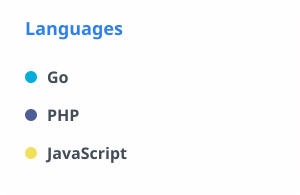
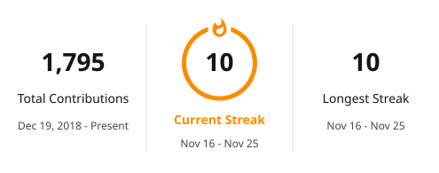

<picture>
  <source media="(prefers-color-scheme: dark)" srcset="./assets/header-dark.svg">
  <source media="(prefers-color-scheme: light)" srcset="./assets/header-light.svg">
  
</picture>

## About

Software engineer working across the full stack of backend concerns: distributed systems, microservices, cloud infrastructure on AWS, API design and DevOps practices. I design and build resilient backend systems in Go and PHP, make architectural decisions, and get into the details when it matters. 8+ years in backend development.

## Tech stack

| Area | Stack |
|---|---|
| Languages | Go, PHP (Laravel, Symfony, Yii2), JavaScript |
| Data | PostgreSQL, MySQL, Redis, Elasticsearch |
| Messaging | RabbitMQ |
| Architecture | Microservice architecture, API gateway, Messaging, Domain event, Transactional outbox, CQRS, Event sourcing |
| API | REST, gRPC, GraphQL |
| AI | LLM integration (OpenAI, Anthropic Claude) |
| DevOps | Docker, Kubernetes, GitHub Actions |
| Testing | Unit, integration and end-to-end testing |
| AWS | EKS, ECR, S3, SQS, Kinesis, Lambda, Glue, Athena, Route 53 |

## GitHub activity

<picture>
  <source media="(prefers-color-scheme: dark)" srcset="./profile/stats-dark.svg">
  <source media="(prefers-color-scheme: light)" srcset="./profile/stats.svg">
  
</picture>
<picture>
  <source media="(prefers-color-scheme: dark)" srcset="./assets/langs-dark.svg">
  <source media="(prefers-color-scheme: light)" srcset="./assets/langs-light.svg">
  
</picture>

<picture>
  <source media="(prefers-color-scheme: dark)" srcset="./profile/streak-dark.svg">
  <source media="(prefers-color-scheme: light)" srcset="./profile/streak.svg">
  
</picture>

<picture>
  <source media="(prefers-color-scheme: dark)" srcset="https://raw.githubusercontent.com/AndreyBBB23/AndreyBBB23/output/github-snake-dark.svg">
  <source media="(prefers-color-scheme: light)" srcset="https://raw.githubusercontent.com/AndreyBBB23/AndreyBBB23/output/github-snake.svg">
  
</picture>

## Contact

[LinkedIn](https://www.linkedin.com/in/andrei-biareshchanka-90282919a)
